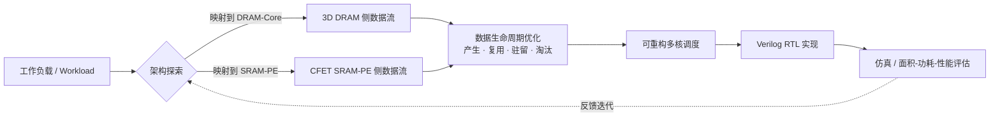
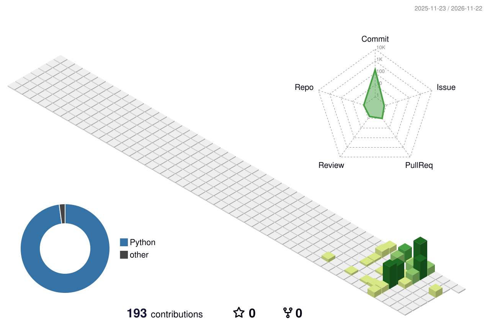

# LibJiang

<a href="https://github.com/LibJiang">
  
</a>

**存算一体 · 3D 垂直集成 · 可重构加速器 · 数字设计**

[](https://www.nju.edu.cn/)
[](https://github.com/LibJiang?tab=repositories&language=verilog)
[](https://github.com/LibJiang)
[](https://github.com/LibJiang)
[](https://github.com/LibJiang)
[](https://github.com/LibJiang)
[](mailto:1920837253@qq.com)

---

## 关于我

我是 **Jade Shark（LibJiang）**，南京大学集成电路（微电子）方向本科生。

我的兴趣落在**体系结构**与**芯片实现**之间那条缝里：往上，关心怎么把算法压成硬件；往下，关心晶体管与互联还能怎么叠。目前在做的两件事，一件是**面向两级垂直存算连接的可重构多核加速器**的架构探索，一件是刚立项、选题仍在磨的**大创项目**。

写 Verilog，写 C/C++，也用 Python 和 PyTorch 做建模、仿真与验证。相信"能跑通的架构图"才算架构图。

> 风雨兼程。

---

## 研究方向：让计算贴着数据长大

传统架构里，数据要跑很远才能被算一次；我想把这段路拆掉。

```text
计算层  ┌──────────────────────────────┐
        │  Reconfigurable PE Array     │
        └──────────────┬───────────────┘
                       │ 垂直互联 ① · CFET SRAM-PE
        ┌──────────────┴───────────────┐
        │  3D DRAM                     │
        └──────────────────────────────┘
存储层
```

- **第一级垂直连接**：CFET SRAM-PE，把存储单元直接长在计算单元上方，缩短访存路径。
- **第二级垂直连接**：3D DRAM-Core，把主存做成"楼"，让带宽随面积一起增长。
- **可重构性**：同一套 PE 阵列，在不同负载下切换数据流与控制流，避免为单一算子做死。
- **数据生命周期优化**：从产生、复用、驻留到淘汰，全链路决定数据"该住在哪一层"，而不是搬来搬去。

## 数据生命周期视角下的架构闭环



---

## 精选项目

### 1. [vs-accel-vertical-storage-compute-accelerator](https://github.com/LibJiang/vs-accel-vertical-storage-compute-accelerator-)

面向两级垂直存算连接（3D DRAM-Core、CFET SRAM-PE）的可重构多核加速器：架构探索与数据生命周期优化。

`Computer Architecture` `CIM` `3D-IC` `Reconfigurable Accelerator`

### 2. [dachuang](https://github.com/LibJiang/dachuang)

大创项目（选题打磨中）。先用 Verilog 把该打的基础打牢，再让题目自己长出来。

`Verilog` `Digital Design` `Research`

> 更多项目正在路上：目前仓库还很空，但每一条 commit 都在往里填东西。

---

## 技术版图

| 方向 | 技术与工具 |
| --- | --- |
| 硬件描述与设计 | Verilog（RTL 设计 · 仿真验证）· Vivado · 数字系统设计 |
| 体系结构 | 存算一体（CIM / Near-Memory Computing）· 3D 垂直集成 · 可重构多核架构 · 数据生命周期优化 |
| 编程语言 | C/C++（系统与底层）· Python（建模 · 仿真 · 数据处理）· Shell |
| 机器学习 | PyTorch（模型搭建 · 训练与推理）· 软硬件协同的算子/模型加速 |
| 工程能力 | Linux · Git / GitHub Actions · 论文复现与实验记录 |

---

## 现在进行时

| 状态 | 内容 |
| --- | --- |
| 主线 | 垂直存算加速器的架构探索：先定数据流，再定 PE 阵列，最后落到 RTL |
| 支线 | 大创选题 · 从"能讲清楚的问题"里挑一个 |
| 在学 | 计算机体系结构、数字集成电路设计、深度学习系统 |
| 想要 | 与做体系结构 / 存算 / 数字设计的人交流，找能一起把图画成硅的人 |

---

## GitHub 足迹

[](https://github.com/LibJiang?tab=repositories)
[](https://github.com/LibJiang?tab=followers)
[](https://github.com/LibJiang?tab=stars)
[](https://github.com/LibJiang/LibJiang/commits)

### 过去一年的 3D 参与度地形

<div align="center">
  <a href="https://github.com/LibJiang?tab=overview">
    
  </a>
</div>

把一年的提交摊成一座等距地形：柱子越高，那天在键盘前坐得越久。
这张图由 GitHub Actions **每天自动重建**，不用手改 —— 我多写一行代码，它就自己长高一格。

<!--
  可选：夜间配色方案（想看星空版就把上面 img 的 src 换成下面这个文件名）
  profile-3d-contrib/profile-night-rainbow-animate.svg

  可选：静态版（不想动画时）
  profile-3d-contrib/profile-green.svg
-->


<!--
  可选：等仓库多起来以后，取消下面两段的注释即可启用贡献图卡片。
  注意 github-readme-stats 在国内访问可能较慢，也可以像 never-die-cold 那样用 Actions 自建。

  

  
-->

---

## 联系

- GitHub：[LibJiang](https://github.com/LibJiang)
- 邮箱：[1920837253@qq.com](mailto:1920837253@qq.com)

**对存算架构、3D 集成、可重构加速器感兴趣，或者想找人一起做数字设计 —— 欢迎来聊。**
